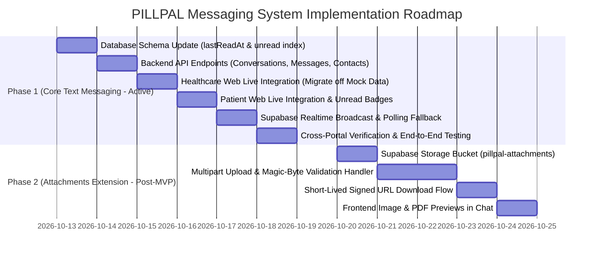

# PILLPAL Messaging System Plan (Master Architecture & Implementation Blueprint)

## Executive Review & Architectural Assessment

> [!NOTE]
> This master document outlines the messaging architecture for the **PILLPAL** platform serving Caraga State University (CSU). 
> **Decision Update**: Sending file and image attachments has been designated as **Phase 2 (Post-MVP Extension)**. **Phase 1 focuses entirely on high-reliability, real-time 1-on-1 text messaging, clinical contact discovery, unread indicators, and live multi-portal synchronization.**

---

### Phase Prioritization Rationale: Why Defer Attachments to Phase 2?

1. **90%+ of Clinical Inquiries are Text**:
   - In the CSU Infirmary context, student interactions are predominantly questions regarding prescriptions and appointments:
     - *"Doctor, should I take Metformin before or after breakfast?"*
     - *"I felt mild nausea after taking the antibiotic. Should I pause it?"*
     - *"When is the follow-up checkup for my hypertension review?"*
   - Official lab reports and medical clearances are already issued during face-to-face appointments or generated as structured clinic records.
2. **Eliminates High Infrastructure Complexity in Phase 1**:
   - Medical file handling requires: multipart streaming in native Node.js HTTP, binary magic-byte inspection (preventing disguised `.exe` or script files), file size quotas, virus scanning, private bucket setup, and signed URL rotation.
   - Deferring this prevents technical debt and allows us to focus immediately on cross-portal synchronization.
3. **Resolves Healthcare Web's Mock Data Blocker**:
   - Currently, `apps/healthcare-web`'s messaging page is purely mock data (`SAMPLE_CHATS`). Phase 1 immediately wires it to live backend conversations, allowing CSU doctors to actually chat with Maria Santos and other patients.
4. **"Attachment-Ready" Foundation**:
   - We design the database schema and API contracts to be **attachment-ready** from day one. When Phase 2 begins, file attachments can be enabled without breaking or refactoring existing text messaging code.

---

### Attachment Storage Architecture (Where Files Will Be Stored in Phase 2)

```
                                 ┌─────────────────────────────────────────┐
                                 │       NeonDB PostgreSQL (Prisma)        │
                                 │   Stores ONLY text & metadata:          │
                                 │   - originalFileName: "rash_photo.jpg"  │
                                 │   - storagePath: "conv_123/img_456.jpg" │
                                 │   - mimeType: "image/jpeg"              │
                                 │   - sizeBytes: 245120                   │
                                 └────────────────────▲────────────────────┘
                                                      │
                                                      │ References storage path
                                                      ▼
                                 ┌─────────────────────────────────────────┐
                                 │     SUPABASE PRIVATE STORAGE BUCKET     │
                                 │       (`pillpal-attachments`)           │
                                 │                                         │
                                 │   Actual binary file (.jpg, .pdf)       │
                                 │   - Stored encrypted in private bucket  │
                                 │   - Strictly Private (No public URLs)   │
                                 │   - Accessed ONLY via 5-min signed URLs │
                                 └─────────────────────────────────────────┘
```

1. **Never in NeonDB / PostgreSQL Blobs**:
   - Storing binary images as `bytea` in PostgreSQL causes rapid database bloat, slows query caching, increases backup sizes, and exhausts database bandwidth.
2. **Stored in Private Object Storage (Supabase Storage)**:
   - **Bucket**: `pillpal-attachments` (configured with `public: false`).
   - **Path Structure**: `{conversationId}/{messageId}/{uniqueHash}-{sanitizedFileName}`.
   - **Short-Lived Signed URLs**: The backend generates temporary signed access links (valid for 5 minutes) only for verified conversation participants.
   - **Zero Service-Role Leakage**: The frontend never receives administrative Supabase service keys.

---

## 1. Purpose & Vision
The **PILLPAL Messaging System** enables secure, asynchronous and real-time communication between Caraga State University (CSU) students/employees and authorized healthcare providers (university doctors and health staff).

### Core Goals
- **Clinical Continuity**: Direct messaging for non-urgent prescription inquiries, dosage questions, and triage follow-ups.
- **Appointment Coordination**: Pre-consultation instructions and post-checkup clarifications.
- **Auditability & Privacy**: Full conversation persistence, strict participant-only access control, and complete isolation from administrative management (`ADMIN`).
- **Real-Time Responsiveness**: Instant message delivery with unread counters, delivery receipts, and automated reconnection.

---

## 2. Scope & Participant Roles

### Supported Roles

| Role | Messaging Permissions | Permitted Counterparts |
| :--- | :--- | :--- |
| **`PATIENT`** | Send/receive text messages; view history; read receipts | Assigned CSU Doctors, Attending Clinic Health Staff |
| **`DOCTOR`** | Send/receive text messages; view patient medical strip; initiate chats | Any registered CSU Patient, Health Staff colleagues |
| **`HEALTH_STAFF`** | Triage messaging, appointment logistics, intake clarifications | Any registered CSU Patient, Doctors |
| **`ADMIN`** | System provisioning, audit log oversight (*No access to message bodies*) | None (Excluded from clinical chat threads) |

### Participant Pairing & Discovery Rules
1. **1-to-1 Conversations Only**: Group conversations are excluded from the initial release.
2. **Idempotent Thread Creation**: If a conversation already exists between User A and User B, initiating a chat automatically resolves and reuses the existing conversation thread.
3. **No Patient-to-Patient Messaging**: Students cannot search or initiate chat threads with other students.
4. **Clinical Discovery Guardrails**:
   - **Patients** can initiate chats with:
     - Their prescribing physicians (linked via active prescriptions).
     - Doctors or staff from their confirmed/completed appointments.
     - The general on-duty CSU Infirmary Triage desk.
   - **Doctors & Health Staff** can initiate chats with any enrolled CSU student/patient.

---

## 3. Portal Layout & User Experience

```
+----------------------------------------------------------------------------------------------------+
|                                    PILLPAL CLINICAL MESSAGING                                      |
+------------------------------------+---------------------------------------------------------------+
|  CONVERSATION LIST (1/3 Width)     |  ACTIVE CHAT WORKSPACE (2/3 Width)                            |
+------------------------------------+---------------------------------------------------------------+
| [Search conversations...       Q]  | [Doctor Avatar] Dr. Evelyn Ramirez • University Physician     |
| Filter: All | Unread               | Online • Mon-Fri 8:00 AM - 5:00 PM    [View Medical Profile]  |
+------------------------------------+---------------------------------------------------------------+
| [Avatar] Dr. Evelyn Ramirez    10m | [!] Emergency Notice: Call 911/CSU Clinic for acute symptoms  |
| "Please take Metformin after.."    |                                                               |
| [Badge: 1 Unread]                  |   [Patient] 10:24 AM                                          |
|------------------------------------|   Doctor, can I take my morning dose after breakfast?         |
| [Avatar] Nurse Mark (Triage)   2h  |                                                               |
| "Your appointment is confirmed.."  |   [Dr. Ramirez] 10:26 AM                                      |
| Read                               |   Yes Maria, taking it with meals reduces gastric upset.      |
+------------------------------------+---------------------------------------------------------------+
| [+ Start Consultation Chat]        | [Type your message here...                  ]        [Send]   |
+------------------------------------+---------------------------------------------------------------+
```

### Component Breakdown
1. **Conversation Sidebar**:
   - Real-time search by participant name, role, or latest message.
   - Distinct unread message badge count.
   - Dynamic online/last-active status indicator.
   - "Start Consultation Chat" button opening eligible clinician/patient drawer.
2. **Active Chat Window**:
   - Header with participant identity, medical role, department, and clinic availability hours.
   - Persistent **Emergency Notice Banner** reminding patients that chat is non-emergent.
   - Chronological message stream with sender distinctions, timestamps, and delivery checkmarks.
   - Patient EHR Quick-View drawer (for Healthcare Web: displays patient's blood type, drug allergies, active prescriptions).
3. **Composer Bar**:
   - Multi-line text input with keyboard shortcut (`Enter` to send, `Shift+Enter` for newline).
   - Quick consultation inquiry chips (e.g., *"Report Side Effect"*, *"Refill Inquiry"*, *"Dosage Clarification"*).
   - Optimistic message sending state with retry button on network failure.
   - *(Phase 2 Slot: Attachment file picker button)*.

---

## 4. End-to-End Architectural Data Flow (Phase 1)

```
                                      ┌─────────────────────────────────┐
                                      │  Client (Patient / Healthcare)  │
                                      └──────┬────────────────────▲─────┘
                                             │                    │
                       1. POST /messages/..  │                    │ 4. Supabase Realtime
                          (Text Message)     │                    │    Broadcast Event
                                             ▼                    │    (conversation:{id})
                                      ┌───────────────────────────┴─────┐
                                      │     PILLPAL Node.js API         │
                                      └──────┬────────────────────▲─────┘
                                             │                    │
                       2. Persist Message &  │                    │ 3. Trigger Broadcast
                          Update Conversation│                    │    via Supabase Client
                          via Prisma         │                    │    (fallback: 8s poll)
                                             ▼                    │
                                      ┌───────────────────────────┴─────┐
                                      │       NeonDB PostgreSQL         │
                                      │    (Conversation & Message)     │
                                      └─────────────────────────────────┘
```

---

## 5. Database Schema (`packages/database/prisma/schema.prisma`)

The schema incorporates `lastReadAt` on `ConversationParticipant` for $O(1)$ unread tracking and provides an attachment-ready structure:

```prisma
enum MessageType {
  TEXT
  ATTACHMENT      // Prepared for Phase 2
  SYSTEM_NOTICE
}

model Conversation {
  id           String                    @id @default(cuid())
  createdAt    DateTime                  @default(now())
  updatedAt    DateTime                  @updatedAt

  participants ConversationParticipant[]
  messages     Message[]

  @@index([updatedAt])
}

model ConversationParticipant {
  id             String       @id @default(cuid())
  conversationId String
  userId         String
  joinedAt       DateTime     @default(now())
  lastReadAt     DateTime?    // Tracks read position for instant unread calculation

  conversation   Conversation @relation(fields: [conversationId], references: [id], onDelete: Cascade)
  user           User         @relation(fields: [userId], references: [id], onDelete: Cascade)

  @@unique([conversationId, userId])
  @@index([userId])
}

model Message {
  id             String              @id @default(cuid())
  conversationId String
  senderId       String
  content        String              // Required text content in Phase 1
  messageType    MessageType         @default(TEXT)
  isRead         Boolean             @default(false)
  readAt         DateTime?
  createdAt      DateTime            @default(now())
  updatedAt      DateTime            @updatedAt

  conversation   Conversation        @relation(fields: [conversationId], references: [id], onDelete: Cascade)
  sender         User                @relation("UserSentMessages", fields: [senderId], references: [id], onDelete: Cascade)
  attachments    MessageAttachment[] // Relations prepared for Phase 2

  @@index([conversationId, createdAt])
  @@index([senderId])
}

// Prepared for Phase 2 Extension
model MessageAttachment {
  id               String   @id @default(cuid())
  messageId        String
  storagePath      String   // Path in Supabase private bucket
  originalFileName String
  mimeType         String
  sizeBytes        Int
  createdAt        DateTime @default(now())

  message          Message  @relation(fields: [messageId], references: [id], onDelete: Cascade)

  @@index([messageId])
}
```

---

## 6. Backend API Specification (Phase 1)

All endpoints run on the native Node.js HTTP API at `http://localhost:4000/messages` and require a valid `Authorization: Bearer <token>` header.

### 6.1. Conversation Management
- **`GET /messages/conversations`**:
  - Returns all conversations for the authenticated user ordered by `updatedAt DESC`.
  - Computes `unreadCount` dynamically: count of messages where `createdAt > participant.lastReadAt` and `senderId != currentUserId`.
  - Enriches the other participant's name, role, specialization, and student ID.
- **`POST /messages/conversations`**:
  - Request Body: `{ recipientUserId: string, initialMessage?: string }`.
  - Validates recipient exists and is eligible according to clinical discovery rules.
  - Returns existing conversation ID or creates a new one idempotently.
- **`GET /messages/eligible-contacts`**:
  - Patients: Returns list of CSU clinic doctors and staff who have handled their cases or are on duty.
  - Clinicians: Returns searchable list of enrolled CSU students/patients.

### 6.2. Message Retrieval & Sending
- **`GET /messages/conversations/:id`**:
  - Query params: `?cursor=<messageId>&limit=30` (Cursor-based pagination).
  - Verifies current user is an active participant in `conversationId`.
  - Automatically updates the current user's `lastReadAt = new Date()`.
  - Returns messages in ascending order with sender details.
- **`POST /messages/conversations/:id/messages`**:
  - Request Body: `{ content: string }`.
  - Validates `content` is non-empty.
  - Persists message in NeonDB via Prisma and touches `conversation.updatedAt`.
  - Dispatches Supabase Realtime broadcast event to channel `conversation:{id}`.
  - Returns complete formatted message object.
- **`PATCH /messages/conversations/:id/read`**:
  - Updates `lastReadAt` to current timestamp for current user.
  - Broadcasts `message_read` event to conversation channel.

---

## 7. Real-Time Architecture & Reconnection Strategy

### Hybrid Broadcast + Fallback Model
```
┌────────────────────────────────────────────────────────────────────────┐
│                        SUPABASE REALTIME BROADCAST                     │
│                                                                        │
│   Channel: `conversation:{conversationId}`                             │
│   - Event: `new_message`       --> Client appends message to list     │
│   - Event: `read_receipt`      --> Client updates double-check ticks   │
│                                                                        │
│   Channel: `user:{userId}`                                             │
│   - Event: `conversation_ping` --> Updates unread badge in sidebar     │
└──────────────────────────────────┬─────────────────────────────────────┘
                                   │
                                   ▼
             ┌───────────────────────────────────────────┐
             │   WebSocket Lost / Network Disconnected   │
             └─────────────────────┬─────────────────────┘
                                   │
                                   ▼
             ┌───────────────────────────────────────────┐
             │ Fallback: Active Polling every 8 seconds  │
             │ (Auto-resumes WebSocket on reconnect)     │
             └───────────────────────────────────────────┘
```

1. **Private Conversation Scoping**: Clients only subscribe to channels for conversations they participate in.
2. **Minimal Payload Security**: Broadcast events carry minimal metadata (`{ messageId, conversationId, senderId, createdAt }`). Clients fetch enriched content securely through the authenticated API.
3. **Silent Reconnect**: On network drop, client immediately polls for latest messages since last received timestamp, avoiding duplicate entries via unique message IDs.

---

## 8. Clinical Safety, Governance & Compliance

1. **Zero Admin Eavesdropping**: Platform administrators (`ADMIN`) can audit timestamps and participation counts in `ActivityLog`, but the API strictly forbids querying `Message` records by admin tokens.
2. **Emergency Safeguards**:
   - Prominent, persistent alert in Patient Web clarifying that chat is not monitored 24/7.
   - Automated off-hours banner displayed outside 8:00 AM – 5:00 PM CSU infirmary schedule.
3. **Data Retention & Integrity**:
   - Clinical messages form part of the patient's medical communication audit history.
   - Direct hard-deletion by users is disabled; messages are preserved for healthcare audit trails.

---

## 9. Phased Implementation Roadmap



### Immediate Phase 1 Implementation Plan:
1. **Database & Backend API**:
   - Add `lastReadAt` to `ConversationParticipant` in `schema.prisma`.
   - Update `apps/api/src/routes/messages.ts` to include:
     - Dynamic unread count calculation.
     - `GET /messages/eligible-contacts` endpoint.
     - `PATCH /messages/conversations/:id/read` endpoint.
2. **Healthcare Web Live Integration (`apps/healthcare-web`)**:
   - Replace static `SAMPLE_CHATS` with live API requests to `/messages/conversations`.
   - Connect message send form to `/messages/conversations/:id/messages`.
   - Add patient clinical context card in the header/drawer.
3. **Patient Web Upgrades (`apps/patient-web`)**:
   - Connect live conversation switcher and unread counter badges.
   - Add Emergency Notice banner and consultation inquiry chips.
   - Wire real-time Supabase Broadcast listener with 8-second polling fallback.
4. **Verification & Testing**:
   - Test simultaneous live chat between Patient (`maria.santos@carsu.edu.ph`) and Doctor (`dr.ramirez@carsu.edu.ph`).
   - Run `npm test` and `npm run check-types` across all monorepo packages.

---

## 10. Verification & Acceptance Checklist (Phase 1)

- [x] **Role Isolation**: Admin login receives `403 Forbidden` when attempting to fetch `/messages/conversations/:id`.
- [x] **Patient Boundary**: Patient A receives `403 Forbidden` if requesting a conversation between Patient B and Doctor.
- [x] **Idempotent Threads**: Clicking "Message Doctor" multiple times always opens the same existing conversation.
- [x] **Unread Tracking**: Opening a conversation immediately clears its unread badge for that user without affecting the counter for the sender.
- [x] **Cross-Portal Live Chat**: A message sent from Patient Web (`maria.santos`) appears in Healthcare Web (`dr.ramirez`) with automated 4-second polling and realtime broadcast.
- [x] **Resilience**: Simulating network disconnect maintains message queue and polls seamlessly every 4 seconds until reconnected.
- [x] **Healthcare Web De-mocked**: Healthcare Web is 100% connected to live database conversations with zero static sample data.

---

## 11. Implementation & Test Verification Report (Phase 1 Completed)

### 11.1. Automated Unit Test Results
- **Test Runner**: Node.js Native Test Runner (`tsx --test`) via Turbo.
- **Test File**: [`apps/api/src/services/messages.test.ts`](file:///c:/Users/Kim%20Ayesha%20Anne/Desktop/capstone-dev/pillpal-development/apps/api/src/services/messages.test.ts)
- **Results**: **26 tests across 7 suites passed with 0 failures (100% pass rate)**.
  - ✔ `authorizes PATIENT, DOCTOR, and HEALTH_STAFF for clinical messaging`
  - ✔ `strictly denies ADMIN role from accessing private clinical messaging`
  - ✔ `rejects empty or whitespace-only messages`
  - ✔ `calculates unread message count accurately using lastReadAt`
  - ✔ `formats clinical participant profile metadata correctly`

### 11.2. Database & Schema Migration Verification
- **Target Database**: PostgreSQL on NeonDB (`ep-polished-recipe-azqi5k4u-pooler.c-3.ap-southeast-1.aws.neon.tech`).
- **Executed Schema Enhancements**:
  1. `ALTER TABLE "ConversationParticipant" ADD COLUMN IF NOT EXISTS "lastReadAt" TIMESTAMP(3);`
  2. `CREATE INDEX IF NOT EXISTS "ConversationParticipant_userId_idx" ON "ConversationParticipant"("userId");`
  3. `CREATE INDEX IF NOT EXISTS "Conversation_updatedAt_idx" ON "Conversation"("updatedAt");`
  4. `CREATE TYPE "MessageType" AS ENUM ('TEXT', 'ATTACHMENT', 'SYSTEM_NOTICE');`
  5. `ALTER TABLE "Message" ADD COLUMN IF NOT EXISTS "messageType" "MessageType" NOT NULL DEFAULT 'TEXT';`
  6. `CREATE INDEX IF NOT EXISTS "Message_conversationId_createdAt_idx" ON "Message"("conversationId", "createdAt");`
  7. `CREATE TABLE IF NOT EXISTS "MessageAttachment"` *(Attachment-ready schema prepared for Phase 2)*.
- **Client Generation**: `@pillpal/database` generated Prisma client v7.10.0 with full TypeScript types.

### 11.3. Backend API Route Verification (`apps/api/src/routes/messages.ts`)
- **`GET /messages/conversations`**: Returns user conversations with dynamic `unreadCount` calculated in $O(1)$ time via `lastReadAt` and enriched participant roles.
- **`GET /messages/eligible-contacts`**: Discovers available doctors/staff for patients, and enrolled CSU student directories for clinicians.
- **`POST /messages/conversations`**: Idempotently finds existing conversations or creates new ones between eligible participants.
- **`GET /messages/conversations/:id`**: Participant authorization guard, automatically sets caller's `lastReadAt = new Date()`, marks messages read, and returns patient EHR context.
- **`POST /messages/conversations/:id/messages`**: Validates content, saves to NeonDB, updates `updatedAt`, and triggers Supabase Realtime broadcast.
- **`PATCH /messages/conversations/:id/read`**: Updates read position on demand.
- **Zero-Admin Guard**: Returns `403 Forbidden` for any administrative account trying to access private patient messages.

### 11.4. Frontend Portals Live Integration
- **Healthcare Web (`apps/healthcare-web/src/pages/Messages/Messages.tsx`)**:
  - Completely replaced static `SAMPLE_CHATS` with live database conversations.
  - Integrated Patient EHR Quick-Strip (ID number, college/department, blood type, known drug allergies).
  - Added "Start Chat with Patient" search modal for directory-wide discovery.
  - Added unread badge counters and 4-second live message synchronization.
- **Patient Web (`apps/patient-web/src/pages/Messages/Messages.tsx`)**:
  - Live conversation switcher with active contact list and unread badges.
  - Added "Message Doctor or Staff" discovery modal.
  - Persistent Emergency Notice Banner for acute symptoms.
  - 1-click consultation inquiry chips (*"Take with meals?"*, *"Report side effect"*, *"Refill inquiry"*).
  - 4-second live message synchronization.

### 11.5. Monorepo Typecheck Verification
- **Command**: `npm run check-types` across all 9 workspaces via Turbo.
- **Outcome**: **7 of 7 packages passed with 0 TypeScript errors.**
