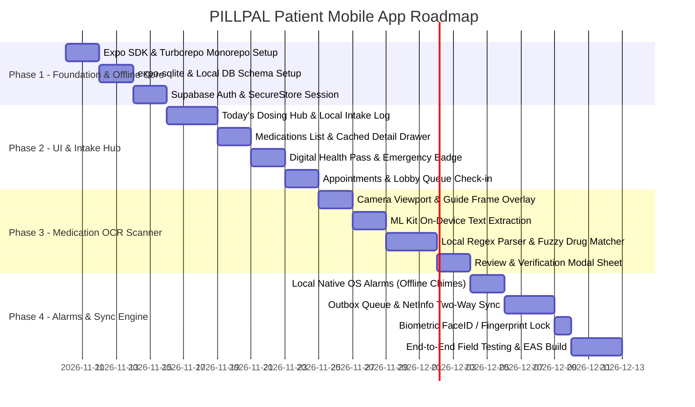

# PILLPAL Patient Mobile App Plan (Master Blueprint)
## Mobile-First Healthcare, Camera OCR & Offline-First Architecture

---

## 1. Purpose & Vision

The **PILLPAL Patient Mobile App** is the mobile-first companion to the PILLPAL healthcare ecosystem, tailored specifically for **Caraga State University (CSU)** students, faculty, and staff. 

While the **Patient Web** provides a desktop/laptop portal for detailed health records and dashboard views, the **Patient Mobile App** addresses the real-world, daily realities of patient adherence:
1. **In-Your-Pocket Medication Reminders**: Alarms and push notifications that ring when a dose is due, even if the app is closed or the device has spotty Wi-Fi on campus.
2. **Camera-Powered Medication OCR (Optical Character Recognition)**: Patients can simply point their smartphone camera at a physical prescription slip, pharmacy bottle label, or blister pack. The app extracts the medication name, dosage strength, schedule, and doctor instructions in seconds without tedious manual typing.
3. **1-Tap Dose Logging & Adherence Verification**: Fast intake confirmation (`TAKEN`, `SKIPPED`, `MISSED`) with optional pill verification scan to prevent medication mix-ups.
4. **Digital Campus Health Pass**: Quick-access barcode/QR code and blood-type/allergy safety badge for instant triage at the CSU Health Services Infirmary.
5. **Real-Time Clinic Consultations & Lobby Check-in**: Live chat with CSU doctors, telehealth video appointments, and 1-tap "I'm in the Clinic Lobby" queue check-in.
6. **True Offline-First Architecture**: Intermittent Wi-Fi or lack of cellular reception in concrete campus halls, laboratories, or rural lodgings will **never** prevent a student from receiving dose alarms, logging intake, scanning medicine, or showing their emergency medical pass.

---

## 2. Target Mobile Technology Stack

```
pillpal-development/
└── apps/
    └── patient-mobile/        <-- React Native + Expo Managed Workflow
```

| Layer | Selected Technology | Why Chosen for PILLPAL |
| :--- | :--- | :--- |
| **Framework** | **React Native + Expo SDK 52+** (TypeScript) | Cross-platform (Android & iOS) from a single TypeScript codebase; seamless Turborepo integration with shared `@pillpal` packages. |
| **Navigation** | **Expo Router v4** | File-based, typed navigation matching web route paradigms; built-in deep links and modal presentations. |
| **Styling** | **NativeWind (Tailwind CSS)** | Shared styling syntax and tokens with `patient-web` and `healthcare-web` (PillPal Emerald `#10b981`, Slate `#0f172a`, Sky Blue `#0284c7`). |
| **Camera & Vision** | **`expo-camera`** + **`@react-native-ml-kit/text-recognition`** | High-performance on-device OCR. Works 100% offline with zero per-scan cloud costs and instant frame processing. |
| **Local Offline Database** | **`expo-sqlite`** (SQLite Relational Store) | Robust local relational database for offline caching, queueing, full-text medication search, and atomic sync transactions. |
| **Authentication** | **`@pillpal/auth`** (Supabase JS) + **`expo-secure-store`** | Secure native keychain storage for JWT tokens, persistent session handling, and biometric unlocking. |
| **Biometrics** | **`expo-local-authentication`** | Face ID, Touch ID, and Android Fingerprint for frictionless, secure login. |
| **Notifications & Alarms** | **`expo-notifications`** + Background Tasks | Local recurring schedule notifications with custom alarm sounds for dose intake reminders (independent of server pings). |
| **Network State** | **`@react-native-community/netinfo`** | Live connectivity monitoring to trigger automatic background synchronization. |
| **State & Mutation Sync** | **TanStack Query (React Query)** | Optimistic UI mutations, automatic garbage collection, and offline cache hydration. |
| **Icons & UI** | **`lucide-react-native`** | Exact matching icon library with the web portals for design consistency. |

---

## 3. The Core Feature: Medication OCR Scanner System

The **Medication OCR Scanner** is the flagship mobile capability that transforms how CSU students interact with their prescriptions.

```
┌─────────────────────────────────────────────────────────────────────────────────┐
│                     ON-DEVICE MEDICATION OCR PIPELINE (100% OFFLINE)            │
├─────────────────────┬───────────────────────────────────────────────────────────┤
│ 1. Capture Viewport │ Camera with rectangular framing guide & text contrast HUD │
│ 2. Edge Processing  │ Auto-crop to label boundary, sharpness & brightness check │
│ 3. On-Device OCR    │ Google ML Kit Text Recognition (offline NPU/CPU, <300ms)  │
│ 4. Medical Parser   │ Local Regex + Philippine drug dictionary entity extractor │
│ 5. Fuzzy Matcher    │ Levenshtein spelling correction against local drug DB     │
│ 6. Human Review     │ Bottom-sheet verification modal with editable fields      │
│ 7. Schedule Commit  │ Saves to local SQLite DB & schedules native phone alarms  │
└─────────────────────┴───────────────────────────────────────────────────────────┘
```

### 3.1. The 3 Primary OCR Use Cases

#### Use Case 1: Prescription Slip Scanner (Doctor's Note)
* **Scenario**: A student visits the CSU Clinic and receives a printed or neatly written prescription slip from the university physician.
* **Flow**:
  1. Student taps **"Scan Prescription"** from the Medications tab.
  2. The camera activates with an A5/A6 document guide.
  3. The on-device OCR extracts:
     - Doctor Name & Clinic License / Header
     - Drug Names (e.g., `Amoxicillin`, `Mefenamic Acid`)
     - Strength (e.g., `500 mg`, `250 mg / 5 mL`)
     - Frequency & Sig (e.g., `1 cap TID pc for 7 days` $\rightarrow$ 3 times a day after meals)
  4. The app translates medical abbreviations (`BID` $\rightarrow$ Twice Daily, `TID` $\rightarrow$ Three Times Daily, `QID` $\rightarrow$ Four Times Daily, `PRN` $\rightarrow$ As Needed, `PC` $\rightarrow$ After Meals, `AC` $\rightarrow$ Before Meals).
  5. The student confirms details and saves all prescribed items in one batch.

#### Use Case 2: Pill Bottle & Blister Pack Scanner (OTC or External Meds)
* **Scenario**: A student purchases over-the-counter medicine (e.g., Paracetamol, Cetirizine, Antacid) or has personal medication from home.
* **Flow**:
  1. Student positions the medicine box or bottle label inside the scanner frame.
  2. The on-device OCR extracts the brand name, generic name, strength, and batch/expiry date.
  3. Auto-suggests safe default dosing rules (e.g., `Every 4-6 hours as needed for fever/pain`).

#### Use Case 3: "Safety Check" Scan Before Intake (Verification Scanner)
* **Scenario**: Student has multiple pill bottles on their desk and wants to verify they are about to take the correct medication.
* **Flow**:
  1. When a dose reminder rings (e.g., *"Time for Amoxicillin 500mg"*), the student taps **"Scan to Verify"**.
  2. A rapid camera view checks the bottle label text against the active prescription.
  3. Match confirmed $\rightarrow$ green checkmark and 1-tap "Mark as Taken". Mismatch $\rightarrow$ prominent warning: *"Wait! This is Ibuprofen, not Amoxicillin."*

---

### 3.2. Offline Medical Entity Extraction & Fuzzy Parser

Because the phone might be offline when scanning, the parser **does not** depend on cloud LLMs or online vision APIs:

```typescript
interface ExtractedMedication {
  brandName?: string;
  genericName: string;
  dosage: string;         // e.g. "500 mg"
  form: string;           // "Capsule" | "Tablet" | "Syrup" | "Drops" | "Inhaler"
  frequency: string;      // "Once daily", "Twice daily", "Three times daily"
  scheduleTimes: string[];// ["08:00 AM", "01:00 PM", "07:00 PM"]
  instructions?: string;  // "Take after meals with water"
  durationDays?: number;  // 7
  confidenceScore: number;// 0.0 - 1.0
  matchedInventoryId?: string; // Links to CSU clinic stock if matched
}
```

#### Parsing Rules & Local Dictionary:
1. **Embedded Philippine & Clinic Drug Dictionary**: Bundled JSON asset containing top 250 common generics and brands (Antibiotics, Analgesics, Antihistamines, Antipyretics, Vitamins, Inhalers).
2. **Offline Levenshtein Fuzzy Correction**: If OCR misreads camera glare as `AM0XIC1LLIN` or `PARACETAM0L`, the local string distance matcher autocorrects to `Amoxicillin` or `Paracetamol` with high confidence.
3. **Strength Regex Patterns**:
   - `(\d+(\.\d+)?)\s*(mg|g|mcg|ml|iu|meq)`
4. **Frequency & Timing Heuristics**:
   - `OD` / `once daily` $\rightarrow$ `["08:00 AM"]`
   - `BID` / `twice daily` / `every 12 hours` $\rightarrow$ `["08:00 AM", "08:00 PM"]`
   - `TID` / `three times daily` / `every 8 hours` $\rightarrow$ `["08:00 AM", "02:00 PM", "08:00 PM"]`
   - `QID` / `four times daily` / `every 6 hours` $\rightarrow$ `["08:00 AM", "12:00 PM", "04:00 PM", "08:00 PM"]`
   - `HS` / `at bedtime` $\rightarrow$ `["09:00 PM"]`
5. **Instruction Indicators**: Detection of keywords: `after meals`, `before meals`, `with food`, `on an empty stomach`, `plenty of water`.

---

## 4. Mobile Navigation & Information Architecture

The mobile app utilizes a **Bottom Tab Bar** (5 main destinations) with stack-based modal presentations:

```
PILLPAL Patient Mobile App
├── (tabs)
│   ├── 1. Today (Home / Dosing Center)
│   │   ├── Streak Counter & Today's Adherence % Ring
│   │   ├── Next Due Dose Card with Countdown Timer
│   │   ├── Intake Feed: Morning, Afternoon, Evening, Bedtime
│   │   │   └── 1-Tap "Take", "Skip", "Snooze"
│   │   ├── Quick Action: "Scan Pill Bottle" (Quick OCR)
│   │   └── CSU Clinic Today: Upcoming Appointment Banner & Lobby Status
│   │
│   ├── 2. Medications (Prescriptions & OCR)
│   │   ├── Active Prescriptions List (with pill icons, dosage, and days left)
│   │   ├── Floating Action Button (FAB): "Scan / Add Medication"
│   │   │   ├── [Camera OCR Scanner]
│   │   │   └── [Manual Entry Form]
│   │   ├── Completed / Past Regimens
│   │   └── 1-Tap "Request Refill from CSU Clinic"
│   │
│   ├── 3. Appointments (Clinic Booking & Triage)
│   │   ├── "Book Consultation" Button (In-Person / Telehealth)
│   │   ├── Upcoming Confirmed Consultations
│   │   │   ├── 1-Tap "I'm in the Clinic Lobby" (Queue Check-in)
│   │   │   └── "Join Video Consultation" (Telehealth Room)
│   │   └── Pending Approval & Consultation History
│   │
│   ├── 4. Messages (Doctor & Staff Chat)
│   │   ├── Conversation List (Attending Doctors & Health Staff)
│   │   ├── Direct Real-Time Chat with Push Notifications
│   │   └── Quick Consultation Starters ("Report Side Effect", "Question on Dosage")
│   │
│   └── 5. Health Pass & Profile
│       ├── Digital CSU Health ID with QR Code
│       ├── Emergency Medical Strip (Blood Type, Allergies, Chronic Conditions)
│       ├── Emergency Contact Dial Button
│       └── Security Settings (Biometric Face ID / Fingerprint toggle)
│
└── Modals / Overlays
    ├── Modal: OCR Live Camera Scanner (with flashlight, guide frame, and scan button)
    ├── Modal: OCR Review & Verification Sheet (edit parsed data before saving)
    ├── Modal: Dose Intake Logger (take/skip reason + optional adherence notes)
    └── Modal: New Appointment Booking Form
```

---

## 5. Screen-by-Screen Specifications

### 5.1. Authentication & Onboarding
* **Sign In Screen**:
  - Dual login options: CSU Google Email (`@carsu.edu.ph`) or CSU ID Number (`2022-04912`).
  - Password entry with show/hide toggle.
  - "Quick Demo Credentials" selector for instant testing.
  - **Biometric Prompt**: After initial login, prompts *"Enable Face ID / Fingerprint for faster sign in?"*. On subsequent launches, biometric auth bypasses manual typing.
  - **Offline Login Support**: Once signed in, biometric credentials allow full access to cached local data even without cellular/Wi-Fi connection.

---

### 5.2. Today's Dosing Center (`/(tabs)/index`)
* **Header**: Patient avatar, current time, dynamic greeting (*"Good morning, Maria"*), and sync badge (`✓ All Synced` or `☁️ 2 actions saved offline`).
* **Adherence Ring & Streak**: Circular progress bar showing today's intake percentage (e.g. `2 of 3 taken - 67%`) and consecutive streak badge (`🔥 12 Days`).
* **Next Dose Hero Card**:
  - Medication name, dosage, schedule time, and intake instruction (e.g., *"Amoxicillin 500mg - Take with food in 25 mins"*).
  - Prominent primary action: **"Take Dose"** (writes immediately to local DB).
  - Secondary action: **"Scan to Verify"** (activates offline OCR camera).
  - Tertiary action: **"Snooze 15m"** or **"Skip"** (prompts for reason: *Nausea, Forgot pill at home, Doctor advised*).
* **Timeline Feed**: Scrollable card list divided into time blocks:
  - 🌅 Morning (6:00 AM - 11:59 AM)
  - ☀️ Afternoon (12:00 PM - 5:59 PM)
  - 🌙 Evening (6:00 PM - 9:59 PM)
  - 🛏️ Bedtime (10:00 PM+)

---

### 5.3. Medications Hub & OCR Scanner (`/(tabs)/medications`)
* **Prescription Cards**:
  - Shows medicine name, dosage, form, prescribing doctor, remaining supply progress bar (e.g., `14 of 21 pills left`), and schedule tags (`8 AM`, `8 PM`).
  - Tap card $\rightarrow$ Detailed medication drawer with complete intake history and safety warnings.
* **Scan Floating Action Button**:
  - High-visibility floating button with camera icon and label: **"Scan Rx / Bottle"**.
* **The OCR Camera Screen (`modal/ocr-scanner`)**:
  - Full-screen live camera preview with dark vignette and clear central rectangular scanning reticle.
  - Top controls: Flashlight toggle (torch), gallery import, close button.
  - Live Reticle Guidance:
    - Reticle turns emerald green when clear high-contrast text is detected.
  - Bottom controls:
    - Mode Switcher: **[Pill Bottle / Box]** | **[Prescription Slip]**
    - Large shutter button: Auto-snaps when steady or manual capture.
* **The OCR Review Sheet (`modal/ocr-review`)**:
  - Shows captured photo thumbnail alongside parsed form fields:
    - **Medication Name** (e.g., `Amoxicillin`)
    - **Dosage Strength** (e.g., `500 mg`)
    - **Form** (e.g., `Capsule`)
    - **Frequency** (e.g., `3 times daily`)
    - **Generated Schedule Times** (e.g., `8:00 AM, 2:00 PM, 8:00 PM`) with 1-tap time adjusters
    - **Duration** (e.g., `7 days`)
    - **Doctor / Instructions** (e.g., `Take after meals`)
  - Editable inputs: Student can adjust any field before final confirmation.
  - Actions: **"Save to My Regimen"** (saves locally & queues sync).

---

### 5.4. Appointments & Clinic Navigation (`/(tabs)/appointments`)
* **Lobby Check-in Banner**:
  - When patient has a confirmed appointment today, a prominent card appears:
    - *"You have an appointment today at 10:30 AM with Dr. Ramirez"*.
    - Big emerald button: **"I Have Arrived at Clinic Lobby"**.
    - If offline: queues the check-in and prompts *"Your check-in is saved and will transmit as soon as you enter clinic Wi-Fi"*.
* **Telehealth Video Room Launcher**:
  - If appointment mode is `TELEHEALTH`, a 1-tap button launches the video consultation room (online only).

---

### 5.5. Real-Time Messages (`/(tabs)/messages`)
* Direct chat with attending CSU doctors and nurses.
* Messages cached locally for offline reading.
* Unsent messages queue in draft status with automatic retry when reconnected.

---

### 5.6. Digital Health Pass & Profile (`/(tabs)/profile`)
* **CSU Campus Health Pass**:
  - Visual digital identification card formatted with CSU gold and green branding.
  - Displays Student ID, Name, College Department, and a generated QR code for kiosk check-in.
  - **100% Accessible Offline**: Paramedics or clinic staff can read blood type, allergies, and emergency phone numbers even if mobile data is completely disabled.
* **Medical Alert Banner**:
  - Bright clinical badge showing **Blood Type** and **Allergies** (e.g. `⚠️ ALLERGIC TO PENICILLIN`).
* **1-Tap Emergency Call**: Direct dialer shortcut to CSU Clinic Emergency Hotline (`085-341-2786`).

---

## 6. Deep Dive: Offline-First Architecture & Sync Engine

In a university campus environment, network dead-zones (concrete buildings, science laboratories, basements, and commuting vans) are common. **Offline is treated as a first-class operating mode, not an exception or error state.**

```
┌─────────────────────────────────────────────────────────────────────────────────┐
│                      OFFLINE-FIRST ARCHITECTURE MATRIX                          │
├───────────────────────┬─────────────────┬───────────────────────────────────────┤
│ Feature               │ Offline Support │ Storage & Execution Engine            │
├───────────────────────┼─────────────────┼───────────────────────────────────────┤
│ Dosing Alarms         │ 100% Offline    │ Native OS AlarmManager / APNs local   │
│ Dose Intake Logging   │ 100% Offline    │ Local SQLite DB + Outbox Sync Queue   │
│ Medication OCR Scan   │ 100% Offline    │ Google ML Kit On-Device Vision Engine │
│ Rx Entity Parsing     │ 100% Offline    │ Local Regex & Levenshtein Drug Lexicon│
│ Emergency Health Pass │ 100% Offline    │ Local SQLite Cached Profile & QR Code │
│ Prescription History  │ Read Offline    │ Local SQLite Cached Records           │
│ Appointment Booking   │ Queued Offline  │ Action added to Outbox Queue          │
│ Clinic Lobby Check-in │ Queued Offline  │ Action added to Outbox Queue          │
│ Telehealth Video Call │ Online Only     │ Requires WebRTC internet connection   │
│ Live Doctor Chat      │ Read/Queue Off  │ Cached history readable; drafts queue │
└───────────────────────┴─────────────────┴───────────────────────────────────────┘
```

---

### 6.1. Local Database Schema (`expo-sqlite`)

The mobile client maintains a local relational database that mirrors the relevant subsets of the server NeonDB schema:

```sql
-- 1. Cached User & Health Pass
CREATE TABLE local_user_profile (
  id TEXT PRIMARY KEY,
  id_number TEXT NOT NULL,
  first_name TEXT NOT NULL,
  last_name TEXT NOT NULL,
  email TEXT NOT NULL,
  department TEXT NOT NULL,
  blood_type TEXT,
  allergies TEXT,
  medical_conditions TEXT,
  emergency_contact_name TEXT,
  emergency_contact_phone TEXT,
  last_synced_at INTEGER NOT NULL
);

-- 2. Cached Prescriptions
CREATE TABLE local_prescriptions (
  id TEXT PRIMARY KEY,
  patient_id TEXT NOT NULL,
  doctor_id TEXT,
  doctor_name TEXT,
  name TEXT NOT NULL,
  dosage TEXT NOT NULL,
  form TEXT,
  instructions TEXT,
  frequency TEXT NOT NULL,
  schedule_times TEXT NOT NULL, -- JSON array string e.g. '["08:00 AM", "08:00 PM"]'
  start_date TEXT NOT NULL,
  end_date TEXT,
  status TEXT NOT NULL DEFAULT 'ACTIVE',
  is_local_draft INTEGER DEFAULT 0, -- 1 if created offline via OCR
  last_synced_at INTEGER NOT NULL
);

-- 3. Local Adherence Logs (Intake History)
CREATE TABLE local_adherence_logs (
  id TEXT PRIMARY KEY, -- Client-generated UUIDv4
  prescription_id TEXT NOT NULL,
  scheduled_time TEXT NOT NULL,
  taken_time TEXT,
  status TEXT NOT NULL, -- 'TAKEN' | 'SKIPPED' | 'MISSED'
  notes TEXT,
  created_at TEXT NOT NULL,
  sync_status TEXT NOT NULL DEFAULT 'PENDING' -- 'PENDING' | 'SYNCED' | 'FAILED'
);

-- 4. Outbox Synchronization Queue
CREATE TABLE sync_outbox (
  id TEXT PRIMARY KEY, -- Client UUIDv4
  endpoint TEXT NOT NULL, -- e.g. '/adherence/batch', '/prescriptions'
  http_method TEXT NOT NULL, -- 'POST' | 'PATCH' | 'PUT'
  payload TEXT NOT NULL, -- JSON string
  idempotency_key TEXT UNIQUE NOT NULL,
  created_at INTEGER NOT NULL,
  retry_count INTEGER DEFAULT 0,
  last_error TEXT
);
```

---

### 6.2. Two-Way Synchronization & Reconciliation Engine

The synchronization engine operates using the **Transactional Outbox Pattern**:

```
                       ┌──────────────────────────────────────────────┐
                       │  Patient Action (e.g. "Take Amoxicillin")    │
                       └──────────────────────┬───────────────────────┘
                                              │
                                              ▼
                       ┌──────────────────────────────────────────────┐
                       │ 1. Atomic Local SQLite Transaction:          │
                       │    a) Insert into local_adherence_logs       │
                       │    b) Enqueue to sync_outbox (UUID key)      │
                       │    c) Optimistic UI Update (0ms delay)       │
                       └──────────────────────┬───────────────────────┘
                                              │
                         ┌────────────────────┴─────────────────────┐
                         │ Device Online? (via NetInfo / ping)      │
                         └────────────┬─────────────────────────────┘
                                      │
                     YES              │             NO
             ┌────────────────────────┘             └────────────────────────┐
             ▼                                                               ▼
┌──────────────────────────────────────────┐                    ┌─────────────────────────┐
│ 2. Flush Outbox Queue:                   │                    │ Sleep until connection  │
│    Send batch POST to Node.js backend    │                    │ restored (NetInfo event)│
│    with client idempotency keys          │                    └─────────────────────────┘
└────────────────────┬─────────────────────┘
                     │
                     ▼
┌──────────────────────────────────────────┐
│ 3. Server Reconciliation:                │
│    - NeonDB persists client timestamps   │
│    - Returns updated server delta        │
└────────────────────┬─────────────────────┘
                     │
                     ▼
┌──────────────────────────────────────────┐
│ 4. Local Cleanup:                        │
│    - Mark adherence log sync_status='OK' │
│    - Delete processed item from outbox   │
│    - Update sync badge to "All Synced"   │
└──────────────────────────────────────────┘
```

#### Conflict Resolution Matrix:
1. **Dose Intake Logs $\rightarrow$ Client Wins**: If a student took their pill at 8:02 AM while offline in a physics lab, that physical human action is authoritative. The server will never overwrite the patient's intake timestamp.
2. **Prescription Status $\rightarrow$ Server (Doctor) Wins**: If an attending university doctor discontinued or updated a prescription from the Healthcare Web portal while the patient was offline, the server's clinical change takes precedence upon reconnection.
3. **Appointment Status $\rightarrow$ Server (Staff) Wins**: When clinic health staff confirm, reschedule, or cancel a consultation, the server state updates the local cache.

---

### 6.3. Local Alarms Subsystem (Works in Airplane Mode)

Standard push notifications (APNs / FCM) fail if the phone has no internet connection. To ensure **100% reliable dose reminders**, PILLPAL uses **Local Operating System Alarms**:

1. When a prescription is added or updated (via OCR or server sync), the mobile app registers native repeating alarms via `expo-notifications`:
   ```typescript
   await Notifications.scheduleNotificationAsync({
     content: {
       title: "💊 Time for your Medication",
       body: `${prescription.name} (${prescription.dosage}) - ${prescription.instructions || "Take with water"}`,
       sound: "pillpal_chime.wav",
       priority: Notifications.AndroidNotificationPriority.MAX,
       categoryIdentifier: "DOSE_REMINDER_CATEGORY",
       data: { prescriptionId: prescription.id, scheduledTime: "08:00 AM" },
     },
     trigger: {
       hour: 8,
       minute: 0,
       repeats: true,
     },
   });
   ```
2. **Actionable Notification Buttons**: Students can tap **"Take Now"** or **"Snooze 15m"** directly from their lock screen without even opening the app.
3. **Device Reboot Resilience**: On Android, an `expo-task-manager` boot receiver restores all scheduled dosing alarms when the phone restarts.

---

### 6.4. Offline UX & Visual States

```
┌────────────────────────────────────────────────────────┐
│  🟢 PILLPAL         [CSU Health]         ☁️ 2 Offline  │
├────────────────────────────────────────────────────────┤
│  ⚡ You are offline. Changes will automatically sync    │
│     when connected to campus Wi-Fi or mobile data.     │
└────────────────────────────────────────────────────────┘
```

* **Non-Intrusive Status Banner**: Instead of disruptive error popups, an amber/slate pill in the header displays connectivity status:
  - `🟢 Synced` (All data up-to-date)
  - `☁️ 2 Queued` (Dose logged offline, waiting for connection)
  - `🔄 Syncing...` (Transmitting outbox to backend)
* **Optimistic Local Feedback**: Intake buttons respond with instant haptic vibrations (`expo-haptics`) and update the adherence streak counter immediately.
* **Offline Guards on Online-Only Features**: Buttons like "Join Video Consultation" display a clear message if tapped while offline: *"Requires internet connection - Available once reconnected"*.

---

## 7. Implementation Roadmap & Phases



### Milestone Breakdown:

1. **Phase 1: Foundation, Workspace & Local Storage**
   - Initialize Expo with TypeScript under `apps/patient-mobile`.
   - Set up `expo-sqlite` with local tables (`local_prescriptions`, `local_adherence_logs`, `sync_outbox`, `local_user_profile`).
   - Integrate `@pillpal/auth` with `expo-secure-store` for persistent offline session tokens.

2. **Phase 2: Core Patient Experience (Offline First)**
   - Implement Today tab with instant 1-tap intake logger writing directly to local SQLite.
   - Implement Digital CSU Health Pass displaying Blood Type and Allergies offline.
   - Implement Appointments and Messages tabs with cached view support.

3. **Phase 3: On-Device Medication OCR Scanner**
   - Integrate `expo-camera` with scanning HUD and reticle guides.
   - Integrate `@react-native-ml-kit/text-recognition` for zero-latency on-device character recognition.
   - Build bundled Philippine & CSU clinic drug dictionary and fuzzy string matcher.
   - Build human-in-the-loop "Review & Confirm" bottom sheet before persisting to SQLite.

4. **Phase 4: Native Alarms & Sync Engine**
   - Implement local repeating alarms via `expo-notifications` that trigger reliably in airplane mode.
   - Implement Outbox synchronization worker with `@react-native-community/netinfo` event listeners.
   - Add biometric authentication (`expo-local-authentication`).
   - Field testing: simulate offline mode, taking pills, turning Wi-Fi back on, and verifying NeonDB data integrity.

---

## 8. Summary & Next Steps

With this architecture, the PILLPAL Patient Mobile App is fully resilient against spotty university connectivity:
* **The student will never miss an intake alarm**, even with zero cellular signal.
* **The student can scan a pill bottle or prescription** in an offline clinic or dorm room.
* **The student can present their emergency medical pass** anytime, anywhere.
* **All dose logs sync seamlessly** in the background the moment campus Wi-Fi reconnects.

When ready to proceed, we will begin with **Phase 1: Initializing `apps/patient-mobile` with Expo SDK and `expo-sqlite`**.
