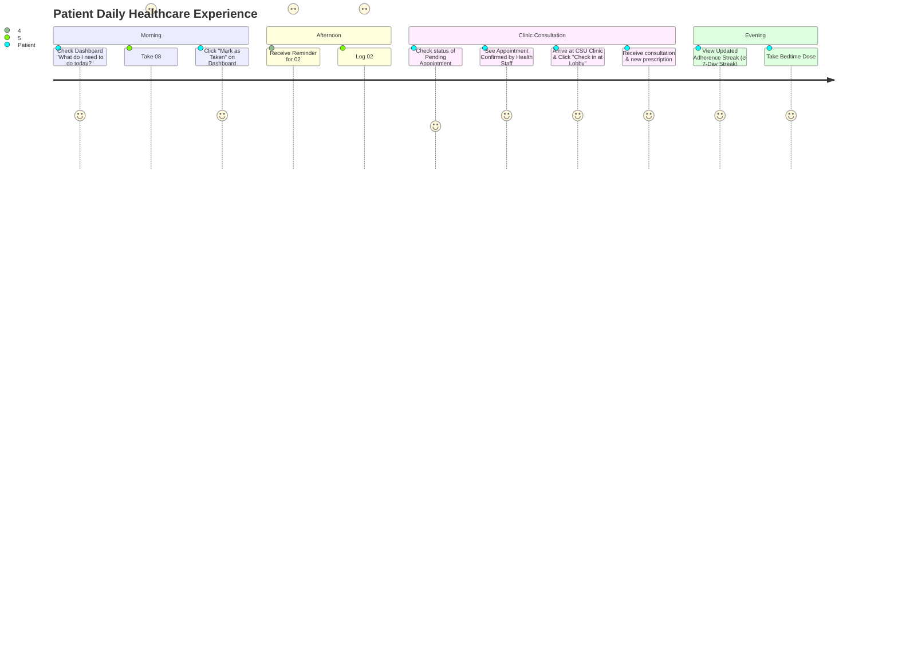
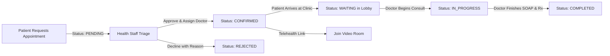
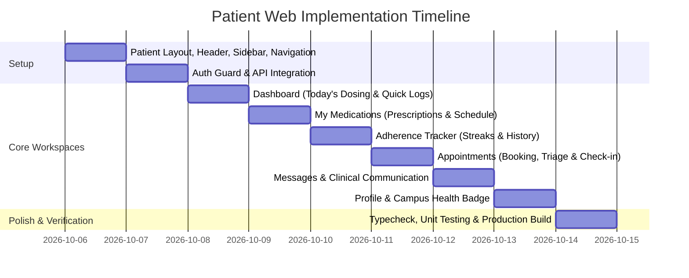

# PILLPAL Patient Web Plan (Master Blueprint)

## 1. Purpose & Vision
The **Patient Web** is the patient's personal healthcare, medication-adherence, and clinical communication portal within the **PILLPAL** ecosystem (serving Caraga State University - CSU students, faculty, and staff).

Its core mission is to empower patients to:
- **Manage & Monitor Prescriptions**: Clearly view active medication regimens, intake schedules, doctor instructions, and remaining supplies.
- **Track Doses & Log Adherence**: 1-click dose recording (`TAKEN`, `SKIPPED`, `MISSED`) with contextual reason tracking and gamified streaks.
- **Request & Navigate Appointments**: Request campus clinic consultations (In-Person & Telehealth), track staff triage, perform 1-tap lobby check-in, and join telehealth video rooms.
- **Direct Healthcare Communication**: Secure real-time messaging with assigned CSU physicians and clinic staff.
- **Emergency Medical Profile**: Access emergency contact details, blood type, known drug allergies (NKA / specific), and university department identity.

> [!NOTE]
> The Patient Web strictly focuses on patient self-management. Administrative features (user provisioning, inventory restocking, clinical prescription creation, and clinic triage) are exclusively reserved for the Healthcare Web and Admin Web portals.

---

## 2. Core Information Architecture & Navigation

```
Patient Web Portal
├── 1. Dashboard ("What do I need to do today?")
│   ├── Today's Dosing Schedule & 1-Click Intake Logger
│   ├── Next Immediate Dose Alert & Countdown
│   ├── Adherence Streak & Weekly Progress Matrix
│   ├── Upcoming CSU Clinic Appointment & Lobby Status
│   └── Quick Action Shortcuts (Request Med Refill, Book Checkup, Emergency Call)
├── 2. My Medications (Prescription Hub)
│   ├── Active Regimens & Dosage Details
│   ├── Intake Timetable (Morning / Afternoon / Evening / Bedtime)
│   ├── Prescribing Doctor & Clinical Intake Instructions
│   ├── Duration & Supply Progress Tracker
│   └── 1-Click "Request Refill / Checkup"
├── 3. Adherence Tracker (Analytics & History)
│   ├── Overall, Weekly, and Monthly Adherence Rate (%)
│   ├── Active Dosing Streak Tracker (🔥 Days in a row)
│   ├── Dose Intake History Calendar & Status Log
│   └── Skipped/Missed Dose Analysis & Doctor Feedback
├── 4. Appointments (Campus Clinic & Telehealth)
│   ├── "Book New Consultation" Form (Reason, Symptoms, In-Person / Telehealth, Preferred Time)
│   ├── Pending Triage Requests (Awaiting Health Staff Approval)
│   ├── Upcoming Confirmed Consultations
│   │   ├── 1-Tap "I Have Arrived at Clinic" (Lobby Check-In)
│   │   └── 1-Click "Join Video Room" (Telehealth)
│   ├── Past Consultations & Doctor Consultation Summaries
│   └── Appointment Cancellation (with Reason)
├── 5. Messages (Clinical Communications)
│   ├── Active Conversations with Attending Doctors & Clinic Staff
│   ├── Real-Time Chat with Read Receipts
│   └── Quick Consultation Presets (Report Side Effect, Refill Inquiry, Dosage Clarification)
└── 6. Profile & Health ID
    ├── CSU Identity Badge (Student / Employee ID, Department / College)
    ├── Emergency Medical Strip (Blood Type, Drug Allergies, Chronic Conditions)
    ├── Emergency Contact Person & Phone
    └── Account Security & Supabase Authentication Settings
```

## 3. Patient Authentication & Sign-In Architecture

```
                       ┌────────────────────────────────────────────────────────┐
                       │              CSU Patient Sign-In Portal                │
                       └──────────────────────────┬─────────────────────────────┘
                                                  │
                       ┌──────────────────────────┴─────────────────────────────┐
                       │ User Identifier Input:                                 │
                       │ - CSU University Email (e.g. maria.santos@carsu.edu.ph)│
                       │   OR                                                   │
                       │ - CSU Student/Employee ID (e.g. 2022-04912)            │
                       └──────────────────────────┬─────────────────────────────┘
                                                  │
                                                  ▼
                        ┌──────────────────────────────────────────────┐
                        │ Identifier format check: Contains '@'?       │
                        └──────┬───────────────────────────────┬───────┘
                               │ NO (ID Number)                │ YES (Email)
                               ▼                               │
        ┌──────────────────────────────────────────────┐       │
        │ POST /auth/patient/lookup                    │       │
        │ Resolves CSU ID -> Account Email             │       │
        └──────────────────────┬───────────────────────┘       │
                               │                               │
                               ▼                               ▼
                        ┌──────────────────────────────────────────────┐
                        │ signIn(targetEmail, password) via Supabase   │
                        │ + Verify PATIENT role with GET /me           │
                        └──────────────────────┬───────────────────────┘
                                               │
                                               ▼
                        ┌──────────────────────────────────────────────┐
                        │ Redirect to /app/dashboard                   │
                        └──────────────────────────────────────────────┘
```

### Key Sign-In & Onboarding Features:
1. **Dual Identification Sign-In**: Students can log in using either their Caraga State University Google Workspace email (`@carsu.edu.ph`) or their physical CSU Student/Employee ID number (`YYYY-XXXXX`).
2. **Student & Patient Self-Registration**: Direct registration workflow allowing new students to sign up with their CSU ID, Academic Department/College, Blood Type, and Known Drug Allergies.
3. **Role & Account Guarding**: Automated `PatientGuard` enforces active status and prevents non-patient users from accessing patient interfaces.
4. **Fast-Fill Demo Credentials**: 1-click test login for seeded CSU patients (e.g., Maria Santos, Juan Dela Cruz).

---

## 4. Patient Journey & Daily Touchpoints



---

## 4. Feature Specifications

### 4.1. Dashboard (`/app/dashboard`)
The dashboard gives immediate, high-priority answers to: **"What medication do I need to take right now, and what appointments are coming up?"**

- **Emergency Alert / Notice Banner**: Campus health bulletins, flu vaccination announcements, or critical intake warnings.
- **Hero Next-Dose Card**:
  - Highlights the immediate next scheduled dose with countdown timer.
  - Quick action: **"Mark Taken"** or **"Skip Dose"**.
- **Today's Intake Schedule Grid**:
  - Morning (08:00 AM), Afternoon (02:00 PM), Evening (06:00 PM), Bedtime (09:00 PM).
  - Status badges: `TAKEN` (Emerald), `PENDING` (Sky Blue), `MISSED` (Amber), `SKIPPED` (Slate).
- **Adherence Snapshot**: Circular progress gauge showing 7-day adherence percentage and active day streak.
- **Appointment Mini-Card**: Shows next confirmed appointment with doctor name, room/telehealth link, and check-in status.

---

### 4.2. My Medications (`/app/medications`)
Displays all active and historical medication regimens issued by licensed CSU clinic physicians.

- **Prescription Cards**:
  - Medication Generic Name & Brand Name (e.g. *Amoxicillin 500mg Capsule*).
  - Dosage Strength & Form.
  - Dosing Frequency & Precise Scheduled Times (`["08:00 AM", "02:00 PM", "08:00 PM"]`).
  - Prescribing Physician (e.g. *Dr. Sarah Jenkins - General Medicine*).
  - Special Clinical Instructions (e.g. *"Take with full glass of water 30 mins after breakfast"*).
  - Duration & Course Progress Bar (e.g. *Day 3 of 7 days completed*).
- **Refill / Follow-up Shortcut**:
  - Button to pre-populate an appointment request for a prescription renewal.
- **Permission Guard**:
  - Read-only for patients. Prescriptions cannot be modified by the patient, protecting clinical integrity.

---

### 4.3. Dose Logging & Adherence (`/app/adherence`)
Empowers patients to track their own intake history and view their adherence performance over time.

- **Dose Action Modal / Quick Buttons**:
  - **Take Dose**: Logs timestamp `takenTime: new Date()`, updates status to `TAKEN`.
  - **Skip Dose**: Prompts for reason selection:
    1. *Forgot / Away from medicine*
    2. *Experiencing nausea / adverse side effect*
    3. *Medication supply ran out*
    4. *Felt completely recovered / not needed*
    5. *Other (custom note)*
- **Adherence Visualizations**:
  - Overall Lifetime Adherence (%).
  - Weekly Adherence Matrix (interactive 7-day dot matrix).
  - Monthly Adherence Graph.
  - Adherence Tier Indicator:
    - 🟢 High Adherence ($\ge 90\%$)
    - 🟡 Moderate Adherence ($70\% - 89\%$)
    - 🔴 Needs Attention ($< 70\%$) with doctor consultation recommendation.

---

### 4.4. Appointments & Consultation Navigation (`/app/appointments`)
Full integration with the 3-Tier Campus Scheduling Engine.



- **Request Appointment Form**:
  - Preferred Date & Preferred Time Slot (Morning 8-12 / Afternoon 1-5).
  - Consultation Mode: `IN_PERSON` (CSU Clinic Infirmary) or `TELEHEALTH` (Video Consultation).
  - Chief Complaint / Reason for Visit.
  - Additional Symptoms & Patient Notes.
- **Active Appointments Feed**:
  - **Pending Triage Tab**: Shows request timestamp and status waiting for health staff review.
  - **Upcoming Confirmed Tab**: Shows assigned Doctor, scheduled time, and location.
    - **"I have arrived at Clinic" button**: Immediately transitions status from `CONFIRMED` $\rightarrow$ `WAITING` in clinic lobby queue.
    - **"Join Video Call" button**: Launches `telehealthUrl` when mode is Telehealth.
    - **"Cancel Appointment" button**: Allows patient to cancel with mandatory reason.
  - **Consultation History Tab**: Displays completed consultations and doctor's clinical instructions.

---

### 4.5. Real-Time Clinical Messaging (`/app/messages`)
Direct communication channel between patients and authorized healthcare providers.

- **Conversation List**: Shows attending doctors and clinic health staff.
- **Chat Feed**:
  - Real-time updates powered by Supabase Realtime / REST API polling fallback.
  - Message bubble formatting (Patient vs. Doctor/Staff).
  - Timestamp & Read status indicators.
- **Consultation Starters**:
  - *"I have a question about my medication dosage."*
  - *"I am experiencing side effects from my prescription."*
  - *"I would like to request an appointment follow-up."*

---

### 4.6. Patient Profile & Emergency Health Badge (`/app/profile`)
Provides a digital campus health profile for safety and records.

- **CSU Identification**: Name, Student/Employee ID Number (e.g., `2022-04912`), Department / College (e.g., `College of Engineering and Geo-Sciences`).
- **Clinical Safety Strip**:
  - Blood Type (e.g. `O+`).
  - Known Allergies (e.g. `Penicillin (Severe)`, `No Known Drug Allergies (NKA)`).
  - Chronic Medical Conditions (e.g. `Asthma`, `Hypertension`).
- **Emergency Contact Info**: Primary contact person name and mobile number.
- **Account Security**: Password change, session logout, and email display.

---

## 5. Technology Stack & Design System

| Layer | Technology |
| :--- | :--- |
| **Frontend** | React 19, Vite, TypeScript |
| **Styling** | Vanilla CSS + Tailwind CSS utilities with curated medical design tokens |
| **Typography** | Geist Variable (`font-sans`), Geist Mono (`font-mono`) |
| **Color Palette** | PillPal Emerald (`#10b981`), Sky Blue (`#0284c7`), Slate Dark (`#0f172a`), Neutral Light (`#f8fafc`) |
| **Icons** | Lucide React |
| **State & API** | Fetch with JWT Auth (`Bearer token`), optimistic UI updates |
| **Backend API** | Node.js REST API (`http://localhost:4000`) |
| **Database** | PostgreSQL on NeonDB with Prisma ORM |
| **Authentication** | Supabase Auth with Role-Based Access Control (`PATIENT`) |

---

## 6. Development & Implementation Roadmap



---

## 7. Security & Compliance Principles
1. **Zero Provider Impersonation**: Patients can never access provider-only endpoints (inventory updates, prescription writing, appointment triage).
2. **Data Privacy**: Patients can only query and view their own `PatientProfile`, `Prescription`s, `AdherenceLog`s, `Appointment`s, and `Conversation`s.
3. **Clinical Immutability**: Prescriptions and doctor SOAP notes are immutable on the patient interface.
4. **Auditability**: Every dose log and appointment check-in is stamped with server-verified timestamps.
