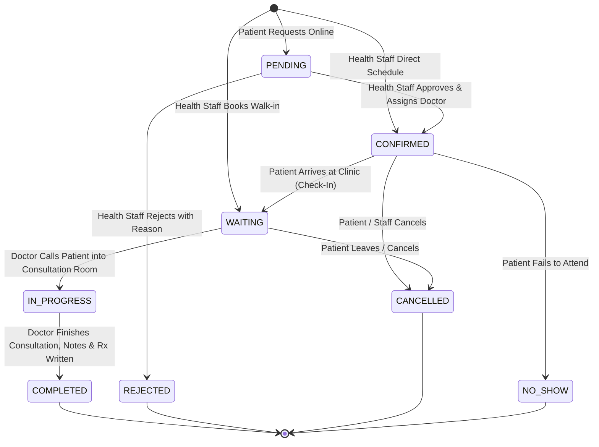

# PILLPAL Scheduling & Clinical Consultation Plan

## 1. Executive Summary & Clinical Purpose

The **PILLPAL Scheduling & Clinical Consultation Module** governs the end-to-end appointment lifecycle across Caraga State University (CSU) students/patients, clinic Health Staff (triage & reception), and Doctors (physicians/healthcare providers).

### Core Principle & Separation of Concerns:
- **Health Staff** acts as the **Clinical Coordinator / Triage Officer**: they review incoming student requests, prevent scheduling conflicts, assign duty doctors, coordinate walk-in arrivals, and manage the clinic waiting lobby.
- **Doctors** act as **Clinical Providers**: they do not triage raw administrative requests; instead, they receive organized, confirmed queues, conduct in-person or telehealth consultations, record diagnostic notes, and issue prescriptions with live clinic inventory integration.
- **Patients (Students / Employees)**: submit booking requests with symptoms/reasons, view real-time queue statuses, and review clinical instructions/prescriptions post-consultation.

---

## 2. Role Responsibilities & Permissions

```mermaid
flowchart LR
    subgraph Patient [Student / Patient]
        P1[Request Appointment]
        P2[Select Date/Time & Reason]
        P3[Track Queue Status]
        P4[Review Rx & Doctor Notes]
    end

    subgraph Staff [Health Staff / Triage]
        S1[Triage Request Queue]
        S2[Assign Duty Doctor]
        S3[Confirm / Reject Request]
        S4[Walk-In Lobby Check-In]
        S5[Reschedule & Coordinate]
    end

    subgraph Doc [Doctor / Physician]
        D1[View Confirmed Schedule]
        D2[Call Patient from Waiting Room]
        D3[Conduct Consultation]
        D4[Record Clinical SOAP Notes]
        D5[Prescribe Medication from Stock]
        D6[Complete Consultation]
    end

    Patient -->|1. Submit Request| Staff
    Staff -->|2. Triage & Assign| Doc
    Doc -->|3. Complete & Prescribe| Patient
```



### Detailed RBAC Matrix:

| Feature / Action | Patient | Health Staff | Doctor | Admin |
| :--- | :---: | :---: | :---: | :---: |
| **Request Appointment (Online)** | ✅ Own | ❌ | ❌ | ❌ |
| **Direct Walk-in Booking & Check-in** | ❌ | ✅ | ✅ | ✅ |
| **Triage & Review Requests** | ❌ | ✅ | ❌ | ✅ |
| **Assign Doctor to Appointment** | ❌ | ✅ | ❌ | ✅ |
| **Approve / Confirm Request** | ❌ | ✅ | ❌ | ✅ |
| **Reject Request (with Reason)** | ❌ | ✅ | ❌ | ✅ |
| **Reschedule Appointment** | ❌ | ✅ | ✅ | ✅ |
| **Cancel Appointment** | ✅ (Own pending) | ✅ | ✅ | ✅ |
| **Mark Patient Arrived (`WAITING`)** | ❌ | ✅ | ✅ | ✅ |
| **Start Consultation (`IN_PROGRESS`)** | ❌ | ❌ | ✅ | ❌ |
| **Record Clinical Notes & Prescribe** | ❌ | ❌ | ✅ | ❌ |
| **Mark Consultation `COMPLETED`** | ❌ | ❌ | ✅ | ❌ |
| **View Own History & Prescriptions** | ✅ Own | ✅ All | ✅ Assigned/All | ✅ All |

---

## 3. Comprehensive Appointment State Machine



### Status Definitions:
1. **`PENDING`**: Initial submission by patient. Waiting for Health Staff triage review and doctor assignment.
2. **`CONFIRMED`**: Health Staff verified doctor availability, approved the time slot, and assigned a physician.
3. **`WAITING`**: Patient has arrived at the CSU Clinic reception lobby and is checked in, ready for the doctor.
4. **`IN_PROGRESS`**: Patient is currently inside the doctor's consultation room / active teleconsult session.
5. **`COMPLETED`**: Consultation concluded. Clinical notes recorded and prescriptions (if any) generated.
6. **`REJECTED`**: Health Staff declined the request (e.g., doctor on leave, incomplete info, referred elsewhere) with a documented reason.
7. **`CANCELLED`**: Cancelled by patient or clinic prior to consultation.
8. **`NO_SHOW`**: Patient did not arrive during their confirmed appointment window.

---

## 4. Key Clinical Workflows

### 4.1. Online Student Booking Workflow
1. Student opens CSU Patient Portal $\rightarrow$ selects **Book Consultation**.
2. Chooses **Consultation Type**:
   - `IN_PERSON`: On-campus CSU Clinic visit.
   - `TELEHEALTH`: Virtual video/chat consultation.
3. Selects preferred date and timeslot.
4. Enters **Chief Complaint / Reason for Visit** (e.g., *"Persistent cough for 3 days and fever"*).
5. Submits request $\rightarrow$ status set to `PENDING`.

### 4.2. Health Staff Triage & Doctor Assignment
1. Health Staff views the **Triage Requests Queue** (`status: PENDING`).
2. Staff reviews student history, reason for visit, and active doctor on-duty rosters.
3. **Approve Action**:
   - Staff selects the assigned **Doctor** (e.g., *Dr. Evelyn Cruz*).
   - Confirms or adjusts scheduled date/time if needed.
   - System transitions status to `CONFIRMED`.
   - Automated notification dispatched to Student and Doctor.
4. **Reject Action**:
   - Staff provides a structured rejection reason (e.g., *"Please visit during emergency walk-in hours or reschedule for next week"*).
   - System marks status as `REJECTED` and notifies student.

### 4.3. Walk-In Clinic Reception Check-In
1. Student walks into the CSU Clinic without a prior online appointment.
2. Health Staff searches student by Name or ID Number (e.g., `2021-0042`).
3. Staff selects **Instant Walk-In Check-In**:
   - Selects reason for visit.
   - Selects available Duty Doctor.
   - System directly creates appointment with status `WAITING` (placed in active lobby queue).

### 4.4. Doctor Consultation & Direct Prescription
1. Doctor logs into Healthcare Web $\rightarrow$ views **Today's Active Queue** (split into *Waiting in Lobby* and *Scheduled Today*).
2. Doctor clicks **"Call Patient / Start Consultation"**:
   - Status transitions from `WAITING` $\rightarrow$ `IN_PROGRESS`.
   - Consultation Workspace opens with:
     - **Patient Clinical Profile**: Vitals, allergies, medical conditions, adherence rate (%).
     - **Past Medical History & Regimens**: Active vs. completed prescriptions.
     - **Clinical SOAP Notes Editor**: Subjective, Objective, Assessment, Plan.
     - **Integrated Medication Prescription Tool**: Search clinic pharmacy inventory in real time and prescribe medication with dosage, route, frequency, and duration.
3. Doctor clicks **"Complete Consultation"**:
   - Status transitions to `COMPLETED`.
   - Clinical notes are permanently saved to patient record.
   - Prescriptions are activated in the patient's PillPal app and synced with inventory.

---

## 5. Database Schema Enhancements

### 5.1. Updated Enums (`packages/database/prisma/schema.prisma`)
```prisma
enum AppointmentStatus {
  PENDING       // Waiting for Health Staff triage review
  CONFIRMED     // Approved by Health Staff, assigned to Doctor
  WAITING       // Patient checked in at clinic lobby
  IN_PROGRESS   // Doctor is currently consulting with patient
  COMPLETED     // Consultation finished, notes/Rx saved
  REJECTED      // Request declined by Health Staff
  CANCELLED     // Cancelled by patient or clinic
  NO_SHOW       // Patient failed to show up
}

enum AppointmentType {
  IN_PERSON
  TELEHEALTH
}
```

### 5.2. Enhanced `Appointment` Model
```prisma
model Appointment {
  id                 String            @id @default(cuid())
  patientId          String
  providerId         String?           // Assigned Doctor
  confirmedById      String?           // Health Staff who triaged/approved

  scheduledAt        DateTime          // Confirmed / target time
  requestedDate      DateTime?         // Initial requested date by patient
  reason             String            // Chief complaint / reason
  type               AppointmentType   @default(IN_PERSON)
  status             AppointmentStatus @default(CONFIRMED)

  // Clinical & Triage Details
  patientNotes       String?           // Additional details provided by patient
  clinicalNotes      String?           // Doctor's SOAP / consultation notes
  rejectionReason    String?           // Reason if rejected by triage staff
  cancellationReason String?           // Reason if cancelled
  telehealthUrl      String?           // Video link if TELEHEALTH

  checkedInAt        DateTime?         // When patient arrived in waiting lobby
  startedAt          DateTime?         // When consultation began
  completedAt        DateTime?         // When doctor finished

  createdAt          DateTime          @default(now())
  updatedAt          DateTime          @updatedAt

  patient            PatientProfile    @relation(fields: [patientId], references: [id], onDelete: Cascade)
  provider           User?             @relation("ProviderAppointments", fields: [providerId], references: [id], onDelete: SetNull)
  confirmedBy        User?             @relation("StaffConfirmedAppointments", fields: [confirmedById], references: [id], onDelete: SetNull)
}
```

---

## 6. REST API Architecture (`apps/api`)

### Endpoints Overview

| Method | Route | Target User | Description |
| :--- | :--- | :---: | :--- |
| `GET` | `/appointments` | Staff / Doctor | List appointments with query filters (`status`, `date`, `doctorId`, `patientId`, `queue=requests\|lobby\|today`) |
| `GET` | `/appointments/:id` | All | Get single appointment with full patient history & notes |
| `POST` | `/appointments` | Patient / Staff | Submit new appointment request or direct walk-in |
| `POST` | `/appointments/:id/confirm` | Health Staff | Approve request, assign doctor, set `CONFIRMED` |
| `POST` | `/appointments/:id/reject` | Health Staff | Decline request with `rejectionReason`, set `REJECTED` |
| `POST` | `/appointments/:id/check-in` | Health Staff | Patient arrived at lobby; set `WAITING`, record `checkedInAt` |
| `POST` | `/appointments/:id/start` | Doctor | Doctor begins consultation; set `IN_PROGRESS`, record `startedAt` |
| `POST` | `/appointments/:id/complete` | Doctor | Complete consultation with `clinicalNotes`, optional prescription, set `COMPLETED` |
| `POST` | `/appointments/:id/reschedule` | Staff / Doctor | Update `scheduledAt` and notify parties |
| `POST` | `/appointments/:id/cancel` | All Authorized | Cancel appointment with `cancellationReason` |

---

## 7. Healthcare Web UI/UX Workspace Design (`apps/healthcare-web`)

### 7.1. Health Staff View: Clinic Scheduling & Triage Center
1. **Triage Request Inbox Tab** (Badge count of pending requests):
   - Review patient card, chief complaint, requested time.
   - Quick action dropdown to **Assign Doctor** + one-click **Approve** or **Reject**.
2. **Today's Live Waiting Room Lobby Tab**:
   - Visual queue of patients checked-in (`WAITING`) and currently consulting (`IN_PROGRESS`).
   - Wait-time counter (e.g., *"Waiting for 12 mins"*).
   - "Direct Walk-In" fast booking button.
3. **Master Clinic Calendar / List View**:
   - Filter by Doctor, Date range, and Consultation type (`IN_PERSON` vs `TELEHEALTH`).

### 7.2. Doctor View: Clinical Consultation Workspace
1. **Today's Patient Queue Tab**:
   - Filtered exclusively to appointments assigned to the logged-in doctor.
   - Highlighting patients currently `WAITING` in the lobby.
2. **Active Consultation Room Modal / View**:
   - Side-by-side view: **Patient Medical Profile** (adherence, allergies) on left; **SOAP Notes + Prescription Writer** on right.
   - Direct button: *"Dispense / Prescribe from Clinic Inventory"*.
   - One-click **"Complete Consultation & Issue Prescription"**.
3. **Past Consultations & Outcomes Tab**:
   - Chronological historical record of completed consults with full clinical notes.

---

## 8. Implementation Roadmap

- [x] **Phase 1: Database Schema & Migration**
  - [x] Update `AppointmentStatus` enum in `packages/database/prisma/schema.prisma` (`PENDING`, `CONFIRMED`, `WAITING`, `IN_PROGRESS`, `COMPLETED`, `REJECTED`, `CANCELLED`, `NO_SHOW`).
  - [x] Add fields: `requestedDate`, `confirmedById`, `patientNotes`, `rejectionReason`, `cancellationReason`, `telehealthUrl`, `checkedInAt`, `startedAt`, `completedAt`.
  - [x] Run `prisma db push` to Neon Postgres and regenerate `@pillpal/database` client.

- [x] **Phase 2: Backend API Expansion (`apps/api/src/routes/appointments.ts`)**
  - [x] Implement query filters (`status`, `date`, `doctorId`, `patientId`, `queue`).
  - [x] Implement triage approval endpoint (`POST /appointments/:id/confirm` with doctor assignment).
  - [x] Implement triage rejection endpoint (`POST /appointments/:id/reject` with reason).
  - [x] Implement lobby check-in endpoint (`POST /appointments/:id/check-in` $\rightarrow$ `WAITING`).
  - [x] Implement consult start endpoint (`POST /appointments/:id/start` $\rightarrow$ `IN_PROGRESS`).
  - [x] Implement consult completion endpoint (`POST /appointments/:id/complete` with clinical notes + prescription creation).
  - [x] Implement rescheduling and cancellation endpoints.
  - [x] Implement `GET /appointments/doctors` for active physician assignment.

- [x] **Phase 3: Healthcare Web UI Redesign (`apps/healthcare-web`)**
  - [x] Build **Triage Requests Inbox** tab with Doctor Assignment and Decline modals.
  - [x] Build **Live Waiting Room Lobby** queue with real-time status and consult triggers.
  - [x] Build **Walk-In Quick Registration** modal for reception staff with direct lobby queue placement.
  - [x] Build **Doctor Consultation Room Workspace** with SOAP clinical notes editor and direct clinic stock prescription writer.
  - [x] Build **Role-Tailored View & KPI Metrics Strip** (Triage, Lobby, All Consultations, Completed Records).

- [x] **Phase 4: Verification & Monorepo Validation**
  - [x] Verify complete lifecycle: Patient Request $\rightarrow$ Staff Triage & Assign $\rightarrow$ Check-In $\rightarrow$ Doctor Consult $\rightarrow$ Complete & Prescribe.
  - [x] Run `npm run check-types` across all packages (0 errors across 9 packages).
  - [x] Run `npm test` (11/11 tests passing).
  - [x] Verify production bundle build `npm run build` (All bundles built successfully).